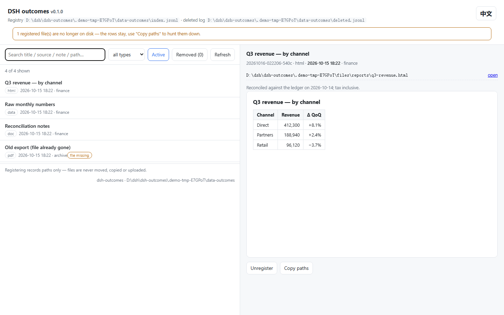

# dsh-outcomes — a deliverables registry for DeepSeek Harness

> Make final artifacts first-class: **agents register them, humans browse them, scripts query them.**
>
> 把「最终成果」变成一等公民：agent 登记，人看图，脚本能查。中文文档见 [README.md](README.md)。

Deliverables (reports, pages, documents, sheets, images, datasets) end up scattered across dozens of folders,
and three days later nobody remembers which one is the final version. This plugin gives them one **registry**:
one JSON object per line with title, type, source, note and originating session — plus an in-app manager page
and a set of agent tools. "Where is that report I asked for" finally has a definite answer.



(Chinese UI: `?lang=zh`, see [`assets/screenshots/manager-zh.png`](assets/screenshots/manager-zh.png).
Both shots are taken from a **running instance** by `node tools/screenshots.mjs` — re-run it when the page changes.)

## What it does / does not do

| Does | Does not |
|---|---|
| Record the **path + metadata** (title / source / note / session) | ❌ never moves, copies or uploads a file |
| Search by keyword, type, state; preview by type (web page & PDF inline, images as thumbnails) | ❌ is not a file manager (no rename, move or delete of files) |
| Unregister → deleted log → put back (**files stay where they are**) | ❌ does not delete sessions or touch DSH session storage |
| Report missing files honestly (registrations are kept, never silently pruned) | ❌ no cloud sync, no reading of file contents (only `stat` for existence) |

## Three entry points

| Entry point | For | Where |
|---|---|---|
| **Agent tools** `outcome_*` | the model | in any conversation — the agent registers what it just produced |
| **Manager page** | you | `http://127.0.0.1:<dsh port>/__dsh-outcomes/` (same origin as the Web UI) |
| **CLI** `dsh-outcomes` | scripts / CI / other agents | your terminal, **DSH does not need to be running** |

## Install

### Option 1 — DSH plugin manager (recommended)

Install the bundle, then **restart DSH** (bundles are loaded at startup):

```
dsh plugin add dsh-outcomes
```

Or add it to your profile `package.json` by hand:

```json
{
  "dependencies": { "dsh-outcomes": "^0.1.0" },
  "dsh": { "profile": { "bundles": ["@deepseek-ai/dsh-base", "@deepseek-ai/dsh-web-app", "dsh-outcomes"] } }
}
```

> **The catch**: being in `dependencies` only downloads it — **only a listing in `dsh.profile.bundles` loads it**.
> That is the host's single switch, and forgetting it means "installed but nothing happened" (silently).

### Option 2 — CLI only

```bash
npm i -g dsh-outcomes        # or: npx dsh-outcomes …
dsh-outcomes add --title "Q3 report" --paths "/reports/q3.html;/reports/q3.csv"
dsh-outcomes list
```

The CLI and the plugin share the same registry format and the same default directory, so both can be mixed freely.

## Configuration

Resolution order (high → low): **plugin config** → **environment variables** → **user settings file** → **defaults**.
Restart DSH after changing it (the plugin resolves config once, at load time).

| key | default | meaning |
|---|---|---|
| `dir` | `$DSH_HOME/plugin-data/dsh-outcomes` | data directory (registry + deleted log) |
| `registry` | `<dir>/index.jsonl` | the registry file (can point elsewhere, e.g. a synced folder) |
| `deleted` | `<dir>/deleted.jsonl` | deleted log |
| `maxTitleLength` | `120` | titles are truncated beyond this |
| `pageSize` | `200` | the manager page's default window (`/api/list` returns this many when no `limit` is given; an explicit `limit` is honoured up to a hard cap of 10000). Typing in the page's search box re-queries the server with `q`, so matches outside the window are still found |
| `allowOutsideCwd` | `true` | allow registering paths outside the session cwd |
| `treatSystemTempAsWarning` | `true` | warn when a path lives in the system temp dir (those files get cleaned up) |

- Environment: `DSH_HOME` (DSH home, default `~/.dsh`), `DSH_OUTCOMES_DIR` (overrides `dir`).
- User settings file: `$DSH_HOME/.dsh-outcomes.json` (same keys; `"//"` comment keys allowed).
- A runnable sample: [`config.example.json`](config.example.json).

## Usage

### CLI

```bash
dsh-outcomes add --title "Q3 report" --paths "a.html;b.csv" --by finance --note "tax inclusive"
dsh-outcomes list [--q text] [--kind html] [--state active|deleted|all] [--limit 20] [--json]
dsh-outcomes check        # are the registered files still there? (exit code 1 when something is gone — CI friendly)
dsh-outcomes remove <id> --why "superseded"
dsh-outcomes restore <id>
dsh-outcomes deleted
dsh-outcomes stats
dsh-outcomes dir          # print the effective data directory
```

Global switches: `--dir <path>`, `--json`. `add` **refuses files that do not exist** unless you pass `--allow-missing`.

### Agent tools

| Tool | Purpose |
|---|---|
| `outcome_add` | register one deliverable (several files separated by `;` count as **one** deliverable) |
| `outcome_list` | search (`q` / `kind` / `state` / `limit`) |
| `outcome_update` | **fix** the metadata of an existing registration (title / source / note / session / type / file list) — correcting beats registering a duplicate |
| `outcome_check` | are the registered files still on disk? |
| `outcome_remove` | unregister (**asks the user first**; the file is untouched) |
| `outcome_restore` | put an unregistered entry back |

### HTTP routes (used by the manager page and by integrations)

| Method | Path | Purpose |
|---|---|---|
| GET | `/__dsh-outcomes/` | manager page (`?lang=zh` for Chinese) |
| GET | `/__dsh-outcomes/api/list?q=&kind=&state=&limit=` | registry as JSON |
| GET | `/__dsh-outcomes/api/status` | size and data directory |
| GET | `/__dsh-outcomes/api/check` | missing-file report |
| GET | `/__dsh-outcomes/api/deleted` | deleted log |
| POST | `/__dsh-outcomes/api/add` | register (guard header required) |
| POST | `/__dsh-outcomes/api/update` | change title / note / source / session |
| POST | `/__dsh-outcomes/api/remove` | unregister (moves to the deleted log) |
| POST | `/__dsh-outcomes/api/restore` | put back |
| GET | `/__dsh-outcomes/file/<id>/<index>` | fetch the n-th file of an entry (preview / download) |

## Data shape

`index.jsonl`, one object per line, **append-only**:

```json
{"id":"20261016-013045-a1b2","title":"Q3 report","kind":"html","paths":["/reports/q3.html"],
 "by":"finance","note":"tax inclusive","sessionId":"session-…","cwd":"/reports","at":"2026-10-16T01:30:45.123Z"}
```

Deleting does **not** erase the line: the whole entry is appended to `deleted.jsonl` (with `removedAt` / `why`),
which is what makes "put back" possible. Every registry rewrite first keeps `<registry>.bak` (single-step undo),
and the rewrite is **self-healing**: entries that disappeared without a deleted-log record get an automatic
`why=auto-archived` entry — so *no registration can vanish silently*.

## Security

- **Paths only**: registering never moves, copies or uploads; the plugin never reads file contents (just `stat`).
- **Never deletes files**: `remove` touches the registry and the deleted log only.
- **Write guard**: every POST must carry `x-dsh-outcomes: 1`, otherwise 403.
  This is not authentication (a same-origin page can send it anyway) — it blocks *cross-site / accidental* writes.
- **Previews are sandboxed**: registered HTML is served with `Content-Security-Policy: sandbox allow-scripts …`,
  so scripts still run (charts!) but the page gets an **opaque origin** and cannot reach your DSH session,
  quota or other local services. Inlining is **only** for web pages / PDF / raster images
  (png, jpg, gif, webp, avif, bmp, ico); everything else — **including SVG**, which can carry scripts —
  is sent as `attachment`. The decision is made per **file** extension, not per entry type, so an entry
  holding both `report.html` and `data.csv` inlines the former and downloads the latter.
- **The file route takes no path**: only `id` and an index are in the URL; paths always come from the registry —
  there is no traversal surface.
- **Loopback only**: routes live on DSH's own web server; the plugin opens no port and sends nothing out.

Full disclosure list: [`docs/CAPABILITY-DISCLOSURE.md`](docs/CAPABILITY-DISCLOSURE.md).

**Why it is built this way** (every trade-off, including its price): [`docs/DESIGN.md`](docs/DESIGN.md) —
append-only JSONL instead of a database, restorable deletions, "re-check and refuse" instead of locking,
per-request page rendering, and no authentication of its own routes.

**Something is wrong** (no settings section / the page 404s / `there is no outcome_add` / entries
landing elsewhere / unregistering fails in automation): see [`docs/TROUBLESHOOTING.md`](docs/TROUBLESHOOTING.md) --
organised by symptom, each with its cause and how to check it.

## Limitations

- **A non-interactive run (headless / automation) cannot unregister**: `outcome_remove` sits behind the host's
  approval gate, and with no approval channel it **fails loudly** (`requires approval, but no approval channel
  is available`) instead of acting quietly — the registry is left untouched. Use the CLI
  (`dsh-outcomes remove <id>`) or the manager page for that. The other five tools are unaffected.

- **No cross-process locking — but a conflict is refused, not overwritten**: every mutating operation is a
  read-modify-write that re-checks the file right before committing. If another process changed it in the
  meantime, the write is skipped and you get `concurrent-modification` instead of silently losing a
  registration. Every rewrite still keeps a `.bak`; `add` is append-only and unaffected.
- **No pagination optimisation**: tens of thousands of entries will slow the manager page down.
- **Existence is computed on read**: `check` is a snapshot; there is no filesystem watcher.
- **No content indexing**: search covers title / source / note / type / path, **not** file bodies.
- **Client-half load failures are silent** (host behaviour): if "Settings → Outcomes" does not show up,
  check that `dsh.client`'s `id` equals the package name — see [`docs/CLIENT-HALF.md`](docs/CLIENT-HALF.md).
- **DSH version**: `engines.dsh >= 0.2.0-rc.2` (written against that build's client assembly contract).

## Development

The host side is **two halves** with different service dependencies: `lib/tools.js` (the six agent tools —
waits only for the `tools` service, so they work in **headless / agent-only profiles** too) and
`lib/index.js` (HTTP routes + manager page — waits for `webServer`, and stays pending, harmlessly, when
there is no web server). Both are inserted by `cordis.patch.yml`; the package entry is the tools half.

```bash
npm test          # node:test, no third-party test framework
npm run check     # per-file syntax check + CLI smoke + leak scan
npm run pack:check
npm run preflight # all of the above; the exit code is the verdict
```

Publishing: [`docs/PUBLISHING.md`](docs/PUBLISHING.md).

## License

MIT
