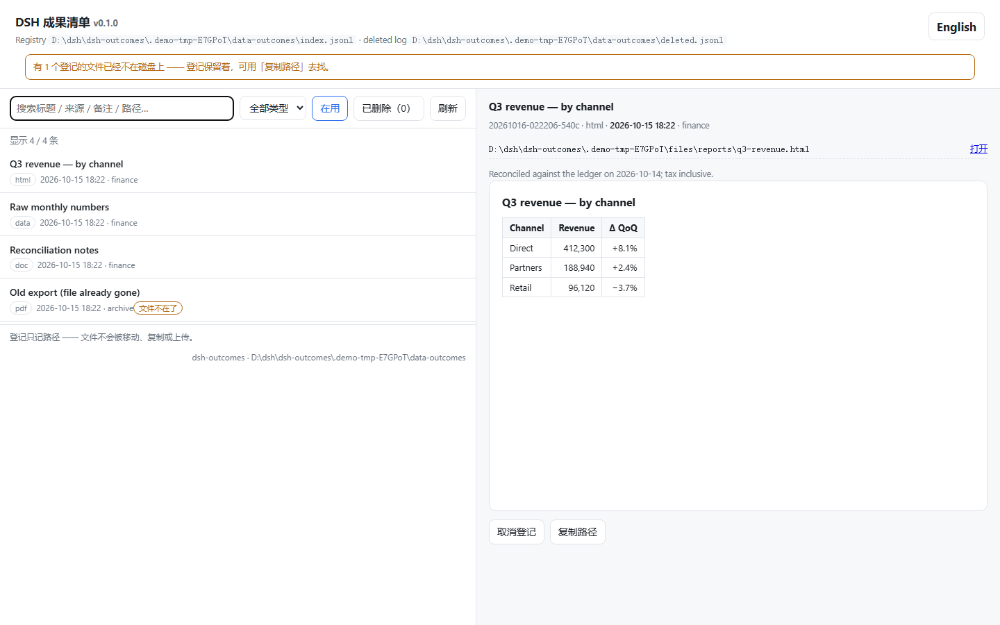

# dsh-outcomes —— DSH 成果管理器

> 把「最终成果」变成一等公民：**agent 登记，人看图，脚本能查**。
>
> A deliverables registry for [DeepSeek Harness](https://github.com/deepseek-ai): agents register final
> artifacts, humans browse them in-app, scripts query them.

干活的产物（报告、网页、文档、表格、图片、数据表）通常散在几十个目录里，三天后谁也记不住哪个是定稿。
这个插件给它们一份**清单**：一行一条 JSON，带标题、类型、来源、备注、关联会话；配一个能在 DSH 里打开的
管理页，和一组 agent 工具 —— 于是"上次要的那份报告在哪"这个问题有了确定答案。

其它语言：[English](README.en.md)



（英文界面：`?lang=en`，截图见 [`assets/screenshots/manager-en.png`](assets/screenshots/manager-en.png)。
两张图都由 `node tools/screenshots.mjs` **跑起来真拍** —— 页面改了就重拍，别让 README 里的图过期。）

## 它做什么 / 不做什么

| 做 | 不做 |
|---|---|
| 登记成果的**路径 + 元数据**（标题/来源/备注/会话） | ❌ 不搬动、不复制、不上传任何文件 |
| 按关键词、类型、状态检索；按类型给预览（网页/PDF 内嵌、图片缩略图） | ❌ 不做文件管理器（改名、移动、删除文件都不归它） |
| 取消登记 → 进删除日志 → 可放回（**文件始终原地不动**） | ❌ 不删会话、不碰 DSH 的会话存储 |
| 文件丢失时如实报告（登记保留，不静默清理） | ❌ 不做云同步、不读取文件内容（只 `stat` 存在性） |

## 三个入口

| 入口 | 谁用 | 在哪 |
|---|---|---|
| **agent 工具** `outcome_*` | 模型 | 任何会话里，模型自己登记刚产出的成果 |
| **管理页** | 你 | `http://127.0.0.1:<DSH 端口>/__dsh-outcomes/`（Web UI 同源） |
| **CLI** `dsh-outcomes` | 脚本 / CI / 别的 agent | 终端，**不需要 DSH 在跑** |

## 安装

### 方式一：GitHub 源（当前可用）

npm 包尚未发布（本机 token 待登录）；现在直接装 GitHub 源，重启 DSH（bundle 只在启动时装载）：

```
dsh plugin add github:xinming-chenniang/dsh-outcomes
```

也可以把 Release 资产 `dsh-outcomes-0.1.0.tgz` 交给插件管理器安装。

### 方式二：npm / 插件管理器（npm 发布后）

`dsh plugin add dsh-outcomes` 只有在 npm 包发布后才可用；当前请用上面的 GitHub 源。

或把包名加进 profile 的 `package.json`：

```json
{
  "dependencies": { "dsh-outcomes": "^0.1.0" },
  "dsh": { "profile": { "bundles": ["@deepseek-ai/dsh-base", "@deepseek-ai/dsh-web-app", "dsh-outcomes"] } }
}
```

> **关键**：装进 `dependencies` 只是下载；**只有列进 `dsh.profile.bundles` 才会被装载**。
> 这是宿主唯一的开关，忘了它 = 装了但什么都没发生（而且不报错）。

### 方式三：只当 CLI 用

npm 尚未发布时，从仓库源码跑：

```bash
node bin/dsh-outcomes.mjs add --title "季度报告" --paths "D:/reports/q3.html;D:/reports/q3.csv"
node bin/dsh-outcomes.mjs list
```

npm 发布后才可用 `npm i -g dsh-outcomes` / `npx dsh-outcomes …`。

CLI 与插件共用同一份清单格式与同一个默认目录，所以两种用法可以混着来。

## 配置

解析顺序（高 → 低）：**插件 config** → **环境变量** → **用户设置文件** → **默认值**。
改完配置要重启 DSH 才生效（插件在装载时解析一次）。

| key | 默认 | 说明 |
|---|---|---|
| `dir` | `$DSH_HOME/plugin-data/dsh-outcomes` | 数据目录（清单与删除日志都在这儿） |
| `registry` | `<dir>/index.jsonl` | 清单文件（可单独指到别处，比如同步盘） |
| `deleted` | `<dir>/deleted.jsonl` | 删除日志 |
| `maxTitleLength` | `120` | 标题超长会被截断 |
| `pageSize` | `200` | 管理页的默认窗口（`/api/list` 不传 `limit` 时给这么多；显式 `limit` 也尊重，硬上限 10000）。**在页面搜索框里输入会带 `q` 重新查服务端**，所以能搜到窗口之外的条目 |
| `allowOutsideCwd` | `true` | 是否允许登记会话 cwd 以外的路径。设为 `false` 时 `add` / `update` 换路径会以 `outside-cwd` 拒收（2026-10-18 起真正生效，此前只解析不执行） |
| `treatSystemTempAsWarning` | `true` | 路径落在系统临时目录时给警告（那些文件随时会被清掉） |

- 环境变量：`DSH_HOME`（DSH 家目录，默认 `~/.dsh`）、`DSH_OUTCOMES_DIR`（覆盖 `dir`）。
- 用户设置文件：`$DSH_HOME/.dsh-outcomes.json`（key 同名；允许 `"//"` 注释键）。
- **一个可跑的样例**：[`config.example.json`](config.example.json)。

## 使用

### CLI

```bash
dsh-outcomes add --title "季度报告" --paths "a.html;b.csv" --by 财务 --note "口径：含税"
dsh-outcomes list [--q 关键词] [--kind html] [--state active|deleted|all] [--limit 20] [--json]
dsh-outcomes check        # 登记的文件还在吗（有缺失 → 退出码 1，方便挂进 CI）
dsh-outcomes remove <id> --why "换版本了"
dsh-outcomes restore <id>
dsh-outcomes deleted
dsh-outcomes stats
dsh-outcomes dir          # 打印当前生效的数据目录（脚本用）
```

全局开关：`--dir <路径>`、`--json`。`add` 默认**拒收不存在的文件**，确实要登记"还没生成的东西"就加 `--allow-missing`。

### agent 工具

| 工具 | 用途 |
|---|---|
| `outcome_add` | 登记一条成果（多个文件用 `;` 分隔，算**一条**成果） |
| `outcome_list` | 检索（`q` / `kind` / `state` / `limit`） |
| `outcome_update` | **改**已有登记的元数据（标题/来源/备注/会话/类型/文件表）—— 写错了就改它，别登记第二条 |
| `outcome_check` | 登记的文件是否还在 |
| `outcome_remove` | 取消登记（**需要用户确认**，文件不动） |
| `outcome_restore` | 把取消登记的条目放回清单 |

### HTTP 路由（管理页与集成用）

| 方法 | 路径 | 说明 |
|---|---|---|
| GET | `/__dsh-outcomes/` | 管理页（`?lang=zh` 中文） |
| GET | `/__dsh-outcomes/api/list?q=&kind=&state=&limit=` | 清单（JSON） |
| GET | `/__dsh-outcomes/api/status` | 规模与数据目录 |
| GET | `/__dsh-outcomes/api/check` | 文件缺失情况 |
| GET | `/__dsh-outcomes/api/deleted` | 删除日志 |
| POST | `/__dsh-outcomes/api/add` | 登记（要守卫头，见下） |
| POST | `/__dsh-outcomes/api/update` | 改标题/备注/来源/关联会话 |
| POST | `/__dsh-outcomes/api/remove` | 取消登记（进删除日志） |
| POST | `/__dsh-outcomes/api/restore` | 放回清单 |
| GET | `/__dsh-outcomes/file/<id>/<序号>` | 取第 n 个文件（预览/下载） |

## 数据形状

`index.jsonl`，一行一条、**只追加**：

```json
{"id":"20261016-013045-a1b2","title":"季度报告","kind":"html","paths":["D:/reports/q3.html"],
 "by":"财务","note":"口径：含税","sessionId":"session-…","cwd":"D:/reports","at":"2026-10-16T01:30:45.123Z"}
```

| 字段 | 说明 |
|---|---|
| `id` | `YYYYMMDD-HHMMSS-<4 hex>`（本地时间 + 随机后缀，同秒不撞） |
| `title` | 人类看的标题，缺省取第一个文件名 |
| `kind` | `html` / `pdf` / `img` / `doc` / `data` / `text` / `other`（按扩展名推） |
| `paths` | **绝对路径**数组；一条成果可含多个文件 |
| `by` / `note` | 来源与注意事项（自由文本） |
| `sessionId` / `cwd` | 产出它的会话与工作目录（可选；取不到就留空） |
| `at` | 登记时刻（ISO） |

删除**不是**抹掉行：整条追加进 `deleted.jsonl`（带 `removedAt` 与 `why`），所以能放回。
清单每次重写都先留 `<清单>.bak`（单步还原），并且**自愈**：重写时发现"上次在、这次不在、删除日志里也没有"
的条目会自动补一条 `why=auto-archived` —— 目的是"再也不会有一条登记无声消失"。

## 安全模型

- **只记路径**：登记不搬动、不复制、不上传文件；插件不读文件内容（只 `stat` 判存在）。
- **不删文件**：`remove` 只动清单与删除日志，文件永远原地不动。
- **写操作要守卫头**：所有 POST 必须带 `x-dsh-outcomes: 1`，否则 403。
  这不是鉴权（同源页面本来就能发请求），而是挡住"别的页面/别的站点误发写请求"这一类。
- **预览是沙箱的**：被登记的 HTML 由宿主以 `Content-Security-Policy: sandbox allow-scripts …` 送出 ——
  脚本能跑（图表要），但拿不到 DSH 的**同源身份**，也就读不到你的会话、配额、其他本地服务。
  内联**只给**网页 / PDF / 位图（png、jpg、gif、webp、avif、bmp、ico）；其余一律 `attachment` 下载，
  其中**包括 SVG**（它是图片但能携带脚本，内联等于放进宿主页面的源里执行）。
  判定按**文件本身**的扩展名，不按条目类型 —— 一条成果里同时有 `report.html` 和 `data.csv` 时，
  前者内联、后者下载。
- **文件路由不吃路径**：URL 里只有 `id` 与序号，路径永远从清单里取 —— 没有目录穿越面。
- **只监听 127.0.0.1**：路由挂在 DSH 自己的 Web 服务上，插件不开新端口、不外传任何数据。

威胁模型与漏洞报告方式见 [SECURITY.md](SECURITY.md)；能力披露的完整清单见 [`docs/CAPABILITY-DISCLOSURE.md`](docs/CAPABILITY-DISCLOSURE.md)。

**为什么这么写**（每条取舍都写了代价）：见 [`docs/DESIGN.md`](docs/DESIGN.md) —— 存储为什么是只追加 JSONL、
删除为什么进留档、并发为什么用"复核 + 拒绝"而不是加锁、页面为什么请求期渲染、路由为什么不自己鉴权。

**出问题了**（设置里没有这一节 / 页面 404 / 说没有 `outcome_add` / 清单写到别处 / 自动化里取消失败…）：
见 [`docs/TROUBLESHOOTING.md`](docs/TROUBLESHOOTING.md) —— 按**症状**查，每条都写清原因与判据。

## 已知限制

- **非交互（headless / 自动化）里无法"取消登记"**：`outcome_remove` 挂在宿主的审批闸门上，
  没有审批通道时它会**明确失败**（`requires approval, but no approval channel is available`）而不是偷偷执行 ——
  清单不会变。要在自动化里取消登记，用 CLI（`dsh-outcomes remove <id>`）或管理页。
  其余五个工具不受影响。

- **跨进程并发不加锁，但会拒绝而不是覆盖**：`update` / `remove` / `restore` 都是「读—改—写」，
  提交前会复核文件有没有被别的进程改过；改过就**不动它**并返回 `concurrent-modification` ——
  两个进程同时写**不会静默丢一条登记**，你会拿到一个明确的失败。每次重写仍留 `.bak`；
  `add` 是追加式的，不受影响。
- **大清单未做分页优化**：几万条时管理页会变慢（服务端有 `limit`，页面默认拉 1000 条做前端过滤）。
- **文件存在性只在读取时计算**：`check` 是快照，不订阅文件系统事件。
- **不做内容索引**：搜索只覆盖标题/来源/备注/类型/路径，**不读文件正文**（也就搜不到正文里的词）。
- **客户端半部的加载失败是静默的**（宿主的既有行为）：如果"设置 → Outcomes"没出现，
  先看 `dsh.client` 的 `id` 是否等于包名 —— 见 [`docs/CLIENT-HALF.md`](docs/CLIENT-HALF.md)。
- **DSH 版本**：`engines.dsh >= 0.2.0-rc.2`（按该版本的客户端装配契约写的）。

## 卸载

- 插件管理器 → remove → **重启 DSH**；
- 或从 profile 的 `dependencies` 与 `dsh.profile.bundles` 删掉 `dsh-outcomes`、删 `node_modules` 里的 junction，重启；
- 清单数据**不会自动删除**：在配置的 `dir`（默认 `$DSH_HOME/plugin-data/dsh-outcomes`，可被设置文件覆盖）里，
  先备份再处理。CLI 与插件共用这份数据。

## 开发

```bash
npm test          # node:test，无第三方测试框架
npm run check     # 逐文件语法检查 + CLI 冒烟 + 泄漏扫描
npm run pack:check
npm run preflight # 上面三条一起跑，退出码即结论
```

两个工具：

```bash
node tools/acceptance.mjs        # 真机装载验收：临时 DSH_HOME + 临时端口起隔离实例，9 步全过才退出码 0
node tools/import-registry.mjs --from <旧清单.jsonl> --dir <目标目录> --dry-run   # 从旧格式迁移（id 原样保留）
```

目录：

```
lib/tools.js   宿主半部①：6 个 agent 工具（只等 tools 服务 —— **headless / 纯 agent profile 里也能用**）
lib/index.js   宿主半部②：HTTP 路由 + 管理页（等 webServer；没有 Web 服务时保持 pending，无害）
lib/store.js    清单核心（零依赖，CLI 与插件共用）
lib/page.js     管理页（请求期渲染，自包含，无构建步骤）
lib/client.js   客户端半部：设置 → Outcomes 分节（手写，无需构建）
lib/paths.js    配置与路径解析（这里保证代码里没有个人路径）
lib/kind.js     扩展名 → 类型
bin/             CLI
test/            六个测试文件（store / host / client / e2e / import / shipped+docs）
tools/           验收（acceptance）/ 迁移（import-registry）/ 自检（check）
```

发布流程见 [`docs/PUBLISHING.md`](docs/PUBLISHING.md)。

## 致谢与来源

它的清单模型来自作者自用控制台里跑了很久的一套成果登记（`outcome.mjs`，含删除留档与自愈），
按"能给社区用"的要求重做：路径全部可配、去掉个人耦合、去掉对宿主内部 API 的依赖、
把"页面是生成物"换成请求期渲染。设计取舍写在 [`CHANGELOG.md`](CHANGELOG.md) 的第一节。

## License

MIT
